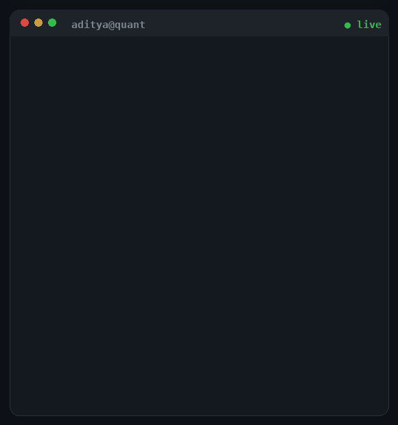

<!-- ═══════════════════ ANIMATED HEADER ═══════════════════ -->
<div align="center">

<picture>
  <source media="(prefers-color-scheme: dark)"
          srcset="https://capsule-render.vercel.app/api?type=waving&color=gradient&customColorList=6,11,20&height=230&section=header&text=Aditya%20Munday&fontSize=68&fontColor=ffffff&animation=fadeIn&fontAlignY=34&desc=Quant%20%C2%B7%20Systems%20%C2%B7%20Backend%20Engineering&descAlignY=56&descSize=20"/>
  
</picture>

<a href="https://github.com/aditya-munday">
  
</a>

<a name="top"></a>

</div>

<!-- ═══════════════════ NAV (click to jump) ═══════════════════ -->
<div align="center">
<sub>

[<kbd>‎ whoami ‎</kbd>](#whoami) · [<kbd>‎ quant ‎</kbd>](#quant) · [<kbd>‎ systems ‎</kbd>](#systems) · [<kbd>‎ skills ‎</kbd>](#skills) · [<kbd>‎ work ‎</kbd>](#work) · [<kbd>‎ signals ‎</kbd>](#signals) · [<kbd>‎ console ‎</kbd>](#console) · [<kbd>‎ connect ‎</kbd>](#connect)

</sub>
</div>

<!-- ═══════════════════ QUANT HERO ═══════════════════ -->
<div align="center">
  
  <br/>
  <sub><i>Markets, models &amp; microstructure — rendered from first principles.</i></sub>
</div>

<br/>

<!-- ═══════════════════ BADGES ═══════════════════ -->
<div align="center">

<a href="https://github.com/aditya-munday?tab=followers"></a>
<a href="https://github.com/aditya-munday?tab=repositories"></a>


</div>


<!-- ═══════════════════ ABOUT ═══════════════════ -->
<a name="whoami"></a>
##  `whoami`

<table>
<tr>
<td width="57%" valign="top">

```cpp
struct Aditya {
    const char* name      = "Aditya Munday";
    const char* domain    = "Quantitative science & backend engineering";
    const char* mission   = "Turn research into deterministic, auditable systems";
    const char* langs[]   = { "C++", "C", "Rust", "Python", "Julia", "R" };
    const char* cloud[]   = { "AWS", "Azure", "Docker", "Linux" };
    const char* values[]  = { "correctness", "latency", "reproducibility" };
};
```

I build at the intersection of **quantitative research**, **systems
engineering**, and **cloud-native backends** — pricing and simulation models in
C++/Rust, and the production services that serve them across AWS and Azure.

Every system I ship is designed to be **deterministic, capability-scoped, and
auditable**: the model you backtested is the model that runs in production.

</td>
<td width="43%" valign="top" align="center">



*From `cargo build` to a green production deploy* —<br/>
deterministic · reproducible · auditable

</td>
</tr>
</table>


<!-- ═══════════════════ QUANT ═══════════════════ -->
<a name="quant"></a>
##  Quantitative science &amp; financial engineering

> *Research → model → backtest → production. No step skipped, no magic.*

<table>
<tr><th align="left">Domain</th><th align="left">What I work on</th></tr>
<tr><td><b>Derivatives &amp; pricing</b></td><td>Option pricing, Greeks, Monte-Carlo &amp; quasi-MC simulation, lattices, stochastic calculus (Itô, SDEs), volatility surfaces — performance-critical C++/Rust implementations.</td></tr>
<tr><td><b>Systematic strategies</b></td><td>Signal generation, alpha research, statistical arbitrage, factor / cross-sectional models, portfolio construction, risk &amp; attribution.</td></tr>
<tr><td><b>Stochastic modelling</b></td><td>GBM, Heston, jump-diffusion, mean-reverting processes, regime-switching; calibration to market quotes.</td></tr>
<tr><td><b>Market microstructure</b></td><td>Order-book modelling, LOB dynamics, execution algorithms (TWAP/VWAP/POV), slippage &amp; transaction-cost analysis.</td></tr>
<tr><td><b>Data &amp; analytics</b></td><td>Time-series econometrics, EWMA volatility, tail-risk (VaR/CVaR), backtesting engines with realistic fills.</td></tr>
<tr><td><b>Numerical methods</b></td><td>Linear algebra (LAPACK/BLAS, Eigen), Monte-Carlo, finite differences, optimisation, FFTs, SIMD &amp; cache-aware hot loops.</td></tr>
</table>

<details>
<summary><b>🤖 AI, ML &amp; model training</b> &nbsp;<sub>(click to expand)</sub></summary>
<br/>

<div align="center">


<br/><br/>
<sub>Deep learning · model training · neural networks · scientific computing in Julia &amp; R</sub>

</div>
</details>


<!-- ═══════════════════ SYSTEMS ═══════════════════ -->
<a name="systems"></a>
##  Systems, backend &amp; cloud

<table>
<tr>
<td width="50%" valign="top">

**Systems, low-level &amp; performance**
- C / C++17-20 — RAII, templates, SIMD, cache-aware design
- Rust — ownership, zero-cost abstractions, `no_std`
- Linux deep systems — syscalls, kernel interfaces, profiling (`perf`, flamegraphs)
- Memory &amp; low-level programming — allocators, layout, cache behaviour
- Performance engineering — hot-loop tuning, latency, benchmarking
- DSA — algorithmic design &amp; complexity analysis
- Cybersecurity — hardening, least privilege, threat modelling

</td>
<td width="50%" valign="top">

**Backend, cloud &amp; data**
- Docker — images, multi-stage builds, compose
- AWS &amp; Azure — compute, storage, IAM, managed data
- PostgreSQL &amp; MySQL — schema design, query tuning
- Backend testing — unit, integration, API contracts (Java)
- Shell — automation, tooling, POSIX pipelines
- Git &amp; GitHub — branching, reviews, CI

</td>
</tr>
</table>


<!-- ═══════════════════ SKILLS ═══════════════════ -->
<a name="skills"></a>
## 🧭 Skills

<div align="center">


<br/>


<br/><br/>


<br/>


</div>


<!-- ═══════════════════ WORK ═══════════════════ -->
<a name="work"></a>
##  Flagship work

<details open>
<summary><b>🧠 Directioner-OS</b> — the AI-native Fedora &nbsp;<sub>(click)</sub></summary>

> *"The differentiator is not that the OS can talk. It is that the OS employs an engineer."*

A Fedora-derived OS with a resident, multi-agent **AI Engineer** that plans,
implements, tests, reviews, ships, monitors and rolls back changes — preserving
determinism, transparency and user sovereignty.

`Fedora bootc` · `Rust workspace` · `SELinux` · `polkit` · `QEMU smoke tests`

</details>

<details>
<summary><b>🛰️ Aria · Aria-Electron</b> — native voice assistant &nbsp;<sub>(click)</sub></summary>

A background desktop assistant that wakes on a word or global shortcut and
surfaces a floating orb — never stealing focus. Typed `aria-core`/`aria-platform`
crates, a versioned desktop ⇄ backend contract, streaming and barge-in.

`Rust` · `TypeScript (Electron)` · `audio` · `wake-word`

</details>

<details>
<summary><b>⌨️ Directioner-CLI</b> — local-first AI coding agent &nbsp;<sub>(click)</sub></summary>

A bring-your-own-key terminal agent that inspects your repo, edits code, runs the
checks that matter, and reports what actually happened. Hardened against prompt
injection, filesystem and terminal abuse.

`TypeScript` · `BYOK` · `--doctor` · `hardened`

</details>

<details>
<summary><b>⚙️ Directioner-Platform-Backend</b> — platform backend &nbsp;<sub>(click)</sub></summary>

Shared identity, AI, data, task, entitlement and integration layer. Never executes
privileged ops itself — it requests them through an explicit allowlist.

`Node 24` · `Fastify 5` · `Zod` · `OpenAPI 3.1` · `Supabase` · `Vitest`

</details>


<!-- ═══════════════════ SIGNALS ═══════════════════ -->
<a name="signals"></a>
##  Signals

<div align="center">

<picture>
    <source media="(prefers-color-scheme: dark)"
            srcset="https://github-readme-stats.vercel.app/api?username=aditya-munday&show_icons=true&hide_border=true&count_private=true&include_all_commits=true&bg_color=0d1117&title_color=39d353&icon_color=39d353&text_color=c9d1d9&ring_color=39d353"/>
    
  </picture>
  <picture>
    <source media="(prefers-color-scheme: dark)"
            srcset="https://github-readme-streak-stats.herokuapp.com/?user=aditya-munday&hide_border=true&background=0d1117&stroke=39d353&ring=39d353&fire=39d353&currStreakLabel=c9d1d9&sideLabels=c9d1d9&dates=c9d1d9"/>
    
  </picture>


</div>


<!-- ═══════════════════ CONSOLE (interactive) ═══════════════════ -->
<a name="console"></a>
## 🖥️ Console

<div align="center">


<br/>
<sub><i>A live terminal — type your own commands in the <a href="https://github.com/aditya-munday/aditya-munday/issues/new?title=console&body=%24%20">console issue</a>.</i></sub>

</div>


<!-- ═══════════════════ CONNECT ═══════════════════ -->
<a name="connect"></a>
##  Connect

<div align="center">

<a href="https://github.com/aditya-munday"></a>
<a href="https://www.linkedin.com/in/aditya-munday/"></a>
<a href="https://leetcode.com/u/aditya-munday/"></a>
<a href="https://www.geeksforgeeks.org/profile/adityamunday"></a>
<a href="https://www.instagram.com/adi.vrse/"></a>
<a href="https://www.threads.net/@adi.vrse"></a>
<a href="mailto:adityamunday@yahoo.com"></a>

<br/><br/>

<a href="#top"><kbd>‎ ↑ back to top ‎</kbd></a>

</div>


<!-- ═══════════════════ FOOTER ═══════════════════ -->
<div align="center">

<a href="https://github.com/aditya-munday">
  
</a>

<br/><br/>

**Quantitative research &amp; systems engineering — one deterministic commit at a time.**

<picture>
    <source media="(prefers-color-scheme: dark)"
            srcset="https://capsule-render.vercel.app/api?type=waving&color=gradient&customColorList=6,11,20&height=150&section=footer"/>
    
  </picture>

</div>
