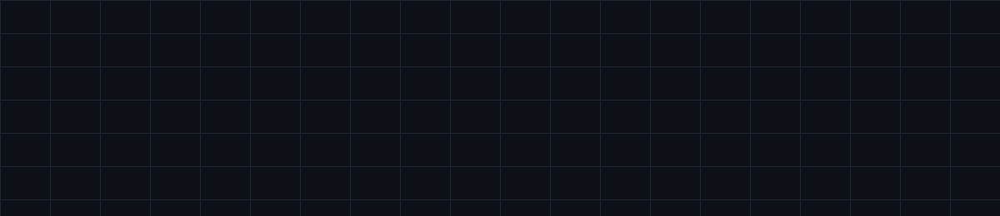
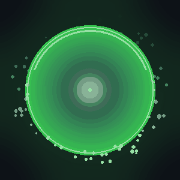

<!-- ═══════════════════ ANIMATED HEADER ═══════════════════ -->
<div align="center">

<picture>
    <source media="(prefers-color-scheme: dark)"
            srcset="https://capsule-render.vercel.app/api?type=waving&color=gradient&customColorList=6,11,20&height=220&section=header&text=Aditya&fontSize=74&fontColor=ffffff&animation=fadeIn&fontAlignY=36&desc=Quant%20%C2%B7%20Systems%20%C2%B7%20Backend%20Engineering&descAlignY=57&descSize=20"/>
    
  </picture>

<a href="https://github.com/aditya-munday">
  
</a>

</div>

<!-- ═══════════════════ QUANT HERO (custom animated asset) ═══════════════════ -->
<div align="center">
  
  <br/>
  <sub><i>Markets, models &amp; microstructure — rendered from first principles.</i></sub>
</div>

<br/>

<!-- ═══════════════════ BADGES ═══════════════════ -->
<div align="center">

<a href="https://github.com/aditya-munday?tab=followers"></a>
<a href="https://github.com/aditya-munday?tab=repositories"></a>


</div>

<!-- ═══════════════════ ABOUT ═══════════════════ -->
<table>
<tr>
<td width="57%" valign="top">

###  `whoami`

```cpp
struct Aditya {
    const char* domain    = "Quantitative science & backend engineering";
    const char* mission   = "Turn research into deterministic, auditable systems";
    const char* langs[]   = { "C++", "C", "Rust", "TypeScript", "Python", "Julia" };
    const char* cloud[]   = { "Kubernetes", "AWS", "Azure", "Docker" };
    const char* values[]  = { "correctness", "latency", "reproducibility" };
};
```

I build at the intersection of **quantitative research**, **systems
engineering**, and **cloud-native backends** — pricing and simulation models in
C++/Rust, and the production services that serve them on Kubernetes across AWS
and Azure.

Every system I ship is designed to be **deterministic, capability-scoped, and
auditable**: the model you backtested is the model that runs in production.

</td>
<td width="43%" valign="top" align="center">



*CPU-rendered orb, pure Rust* —<br/>
[`orb`](https://github.com/aditya-munday/orb) · MIT


</td>
</tr>
</table>


<!-- ═══════════════════ QUANT & FINANCIAL ENGINEERING ═══════════════════ -->
##  Quantitative science &amp; financial engineering

> *Research → model → backtest → production. No step skipped, no magic.*

<table>
<tr><th align="left">Domain</th><th align="left">What I work on</th></tr>
<tr><td><b>Derivatives &amp; pricing</b></td><td>Option pricing, Greeks, Monte-Carlo &amp; quasi-MC simulation, lattices, stochastic calculus (Itô, SDEs), volatility surfaces — performance-critical C++/Rust implementations.</td></tr>
<tr><td><b>Systematic strategies</b></td><td>Signal generation, alpha research, statistical arbitrage, factor / cross-sectional models, portfolio construction, risk &amp; attribution.</td></tr>
<tr><td><b>Stochastic modelling</b></td><td>GBM, Heston, jump-diffusion, mean-reverting processes, regime-switching; calibration to market quotes.</td></tr>
<tr><td><b>Market microstructure</b></td><td>Order-book modelling, LOB dynamics, execution algorithms (TWAP/VWAP/POV), slippage &amp; transaction-cost analysis.</td></tr>
<tr><td><b>Data &amp; analytics</b></td><td>Time-series econometrics, EWMA volatility, tail-risk (VaR/CVaR), backtesting engines with realistic fills.</td></tr>
<tr><td><b>Numerical methods</b></td><td>Linear algebra (LAPACK/BLAS, Eigen), Monte-Carlo, finite differences, optimisation, FFTs, SIMD &amp; cache-aware hot loops.</td></tr>
</table>

<div align="center">


</div>


<!-- ═══════════════════ SYSTEMS & BACKEND ═══════════════════ -->
##  Systems, backend &amp; cloud

<table>
<tr>
<td width="50%" valign="top">

**Systems &amp; low-level**
- C / C++17-20 — RAII, templates, SIMD, cache-aware design
- Rust — ownership, zero-cost abstractions, `no_std`
- Concurrency, lock-free structures, memory model
- Linux internals, syscalls, profiling (`perf`, flamegraphs)

</td>
<td width="50%" valign="top">

**Backend &amp; cloud-native**
- TypeScript / Node.js — strict ESM, Fastify, Zod, OpenAPI
- Kubernetes — deployments, services, HPA, operators
- AWS &amp; Azure — compute, storage, IAM, managed data
- Postgres · Redis · event streams (NDJSON, Kafka-style)

</td>
</tr>
</table>

### ☁️ Cloud, containers &amp; data
<div align="center">


</div>


<!-- ═══════════════════ FLAGSHIP WORK ═══════════════════ -->
##  Flagship work

### 🧠 [Directioner-OS](https://github.com/aditya-munday/Directioner-OS) — the AI-native Fedora
> *"The differentiator is not that the OS can talk. It is that the OS employs an engineer."*

A Fedora-derived OS with a resident, multi-agent **AI Engineer** that plans,
implements, tests, reviews, ships, monitors and rolls back changes — preserving
determinism, transparency and user sovereignty.

`Fedora bootc` · `Rust workspace` · `SELinux` · `polkit` · `QEMU smoke tests`

### 🛰️ [Aria](https://github.com/aditya-munday/Aria) · [Aria-Electron](https://github.com/aditya-munday/Aria-Electron) — native voice assistant
A background desktop assistant that wakes on a word or global shortcut and
surfaces a floating orb — never stealing focus. Typed `aria-core`/`aria-platform`
crates, a versioned desktop ⇄ backend contract, streaming and barge-in.

`Rust` · `TypeScript (Electron)` · `audio` · `wake-word`

### ⌨️ [Directioner-CLI](https://github.com/aditya-munday/Directioner-CLI) — local-first AI coding agent
A bring-your-own-key terminal agent that inspects your repo, edits code, runs the
checks that matter, and reports what actually happened. Hardened against prompt
injection, filesystem and terminal abuse.

`TypeScript` · `BYOK` · `--doctor` · `hardened`

### ⚙️ [Directioner-Platform-Backend](https://github.com/aditya-munday/Directioner-Platform-Backend) — platform backend
Shared identity, AI, data, task, entitlement and integration layer. Never executes
privileged ops itself — it requests them through an explicit allowlist.

`Node 24` · `Fastify 5` · `Zod` · `OpenAPI 3.1` · `Supabase` · `Vitest`

<br/>


<!-- ═══════════════════ STATS ═══════════════════ -->
##  Signals

<div align="center">

<picture>
    <source media="(prefers-color-scheme: dark)"
            srcset="https://github-readme-stats.vercel.app/api?username=aditya-munday&show_icons=true&hide_border=true&count_private=true&include_all_commits=true&bg_color=0d1117&title_color=39d353&icon_color=39d353&text_color=c9d1d9&ring_color=39d353"/>
    
  </picture>
  <picture>
    <source media="(prefers-color-scheme: dark)"
            srcset="https://github-readme-streak-stats.herokuapp.com/?user=aditya-munday&hide_border=true&background=0d1117&stroke=39d353&ring=39d353&fire=39d353&currStreakLabel=c9d1d9&sideLabels=c9d1d9&dates=c9d1d9"/>
    
  </picture>


</div>


<!-- ═══════════════════ CODING ACTIVITY (WakaTime) ═══════════════════ -->
##  Coding activity

<!-- ✏️ Replace WAKATIME-USERNAME below with your WakaTime handle to activate this card -->
<div align="center">

<picture>
  <source media="(prefers-color-scheme: dark)"
          srcset="https://github-readme-stats.vercel.app/api/wakatime?username=WAKATIME-USERNAME&layout=compact&hide_border=true&bg_color=0d1117&title_color=39d353&text_color=c9d1d9"/>
  
</picture>

<br/>
<sub>Weekly breakdown of languages &amp; editors — powered by <a href="https://wakatime.com">WakaTime</a>.</sub>

</div>


<div align="center">

> ⚠️ **Placeholders below** — replace each `YOUR-*` handle with your real profile, or ask me to fill them in.
> I did not guess automatically: web results showed **two different people** named "Aditya Munday",
> so I left these blank rather than link the wrong account.

</div>

<!-- ═══════════════════ CONNECT ═══════════════════ -->
##  Connect

<div align="center">

<!-- ✏️ EDIT the href values below with your real profiles -->
<a href="https://github.com/aditya-munday"></a>
<a href="https://www.linkedin.com/in/YOUR-LINKEDIN"></a>
<a href="https://x.com/YOUR-HANDLE"></a>
<a href="https://leetcode.com/YOUR-HANDLE"></a>
<a href="https://www.kaggle.com/YOUR-HANDLE"></a>
<a href="https://codeforces.com/profile/YOUR-HANDLE"></a>
<a href="mailto:your.email@example.com"></a>

</div>


<!-- ═══════════════════ QUOTE ═══════════════════ -->
<div align="center">

<a href="https://github.com/aditya-munday">
  
</a>

<br/><br/>

**Quantitative research &amp; systems engineering — one deterministic commit at a time.**

<picture>
    <source media="(prefers-color-scheme: dark)"
            srcset="https://capsule-render.vercel.app/api?type=waving&color=gradient&customColorList=6,11,20&height=150&section=footer"/>
    
  </picture>

</div>
